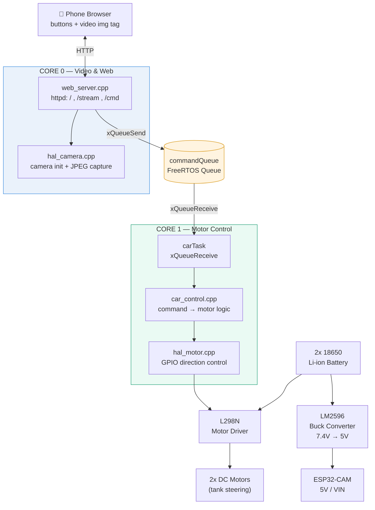

# ESP32-CAM WiFi RC Car

A phone-controlled RC car with live video streaming, built on an ESP32-CAM.
Control the motors and watch the live camera feed from a single web page served
directly by the car — no app install, no cloud, no router required.

This is a hands-on embedded systems project built while learning ESP-IDF,
FreeRTOS, and embedded C++ from the ground up (electronics fundamentals →
protocols → RTOS → applied architecture).

---

## Features

- **Live video stream** (MJPEG over HTTP) rendered in any phone browser
- **Button-based motor control** (forward / backward / left / right / stop)
- **WiFi Access Point** — the car hosts its own network, no router needed
- **Dual-core task split** — video/web server on Core 0, motor control on Core 1,
  so a busy video stream never starves the control loop
- **Hardware Abstraction Layer (HAL)** — motor and camera drivers are isolated
  behind clean interfaces; swapping hardware means touching one file, not the
  whole codebase
- **Autonomous battery power** — runs entirely off two 18650 Li-ion cells,
  no USB tether required

---

## Architecture



**Why two cores?** The video stream handler runs a tight, continuous loop
capturing and sending JPEG frames — if it shared a core with motor control,
a slow frame could delay a steering command. Pinning the HTTP server to
Core 0 and the motor task to Core 1 keeps control responsive regardless of
video load.

**Why a HAL?** `car_control.cpp` never touches a GPIO pin directly — it calls
`motorSet(LEFT, FORWARD, speed)` and lets `hal_motor.cpp` worry about which
physical pin does what. This meant the entire control logic was written and
tested (via host-side mocks) **before** the hardware even arrived, and moving
from a plain ESP32 dev board to the ESP32-CAM later required changing only
four pin constants in one file.

---

## Hardware

| Component | Role |
|---|---|
| **ESP32-CAM** (AI-Thinker-style, GC2145 sensor) | Main MCU: WiFi, web server, camera capture |
| **ESP32-CAM-MB** | USB programmer / serial adapter for flashing |
| **L298N** | Dual H-bridge motor driver |
| **2x TT gear motors + wheels** | Drive (tank-steering chassis) |
| **2x 18650 Li-ion cells + holder** | Main power source |
| **LM2596** | Step-down (buck) converter, battery voltage → stable 5V for the ESP32 |

### Pin map (ESP32-CAM, AI-Thinker pinout)

| Signal | GPIO |
|---|---|
| Motor A — IN1 | GPIO13 |
| Motor A — IN2 | GPIO14 |
| Motor B — IN1 | GPIO15 |
| Motor B — IN2 | GPIO4 |
| Camera (PWDN / XCLK / SIOD / SIOC / Y2–Y9 / VSYNC / HREF / PCLK) | Fixed by AI-Thinker board layout |

> **Note on strapping pins:** GPIO0, GPIO2, GPIO12, and GPIO15 affect the
> ESP32's boot mode and can carry an unpredictable logic level for a brief
> moment at power-on. Driving an H-bridge input from one of these pins risks
> both motor-driver inputs on one side momentarily agreeing, shorting the
> H-bridge internally. This project avoids GPIO0/2/12 for motor control after
> losing an L298N to exactly this failure mode during development.

### Power architecture

Two independent power rails sharing a common ground:

- **Motors**: battery → L298N directly (7.4V nominal from 2x 18650 in series)
- **ESP32-CAM**: battery → LM2596 (stepped down to 5V) → ESP32-CAM 5V/VIN pin

All grounds (battery, L298N, LM2596, ESP32-CAM) are tied together — required
for the logic-level control signals (IN1–IN4) to have a common reference.

---

## Software stack

- **Framework:** ESP-IDF (native, not Arduino) via PlatformIO
- **Language:** C++ (embedded subset — no exceptions, no heavy STL, minimal
  dynamic allocation in the hot paths)
- **RTOS:** FreeRTOS (tasks, queues, dual-core task pinning)
- **Camera driver:** `espressif/esp32-camera` component
- **Networking:** ESP-IDF native WiFi (SoftAP) + `esp_http_server`

### Project structure

```
src/
├── main.cpp          — orchestration only: init + task creation
├── hal_motor.h/.cpp   — motor HAL: direction + (future) PWM speed control
├── car_control.h/.cpp — command → motor mapping (tank-steering logic)
├── hal_camera.h/.cpp  — camera init + JPEG frame capture
└── web_server.cpp     — WiFi AP, HTTP routes, video stream, control page
```

Each layer only talks to its neighbor:

```
car_control  →  hal_motor  →  GPIO
web_server   →  hal_camera →  esp_camera driver
web_server   →  commandQueue  →  carTask  →  car_control
```

---

## Running it

1. Flash via the ESP32-CAM-MB programmer (hold IO0, press RST, upload, release
   IO0, press RST again to boot normally).
2. Connect your phone to the WiFi network **`ESP32-Car`** (password `12345678`).
3. Open `http://192.168.4.1` in a browser.
4. Drive using the on-screen buttons while watching the live feed.

---

## What this project demonstrates

- Reading datasheets and pin-outs to resolve real hardware incompatibilities
  (e.g. identifying an unlabeled GC2145 sensor, working around a legacy
  `esp32-camera` library's conflicts with a newer ESP-IDF I2C driver)
- Debugging a live short circuit back to its root cause (a strapping-pin
  conflict at boot) rather than just replacing the part
- Structuring embedded C++ with a Hardware Abstraction Layer so application
  logic is portable, testable off-device, and survives a hardware swap
- Using FreeRTOS primitives (tasks, queues, core pinning) deliberately to
  solve a real responsiveness problem, not just because they're available

---

## Roadmap

- [ ] PWM-based variable speed control (currently full-speed only — no ENA/ENB
      broken out on this L298N board)
- [ ] Host-side unit tests for `car_control.cpp` logic
- [ ] Switch to an OV2640-based camera module for hardware JPEG encoding
      (current GC2145 requires software `frame2jpg` compression)
